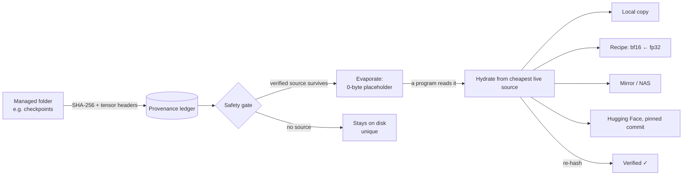

<p align="center"></p>

<h1 align="center">Marea</h1>

<p align="center"><b>Your AI models eat your disk. Marea gives the space back — without deleting a byte —<br>and tells you which models could run code when you load them.</b></p>

<p align="center">
  <b>English</b> ·
  <a href="docs/i18n/README.it.md">Italiano</a> ·
  <a href="docs/i18n/README.es.md">Español</a> ·
  <a href="docs/i18n/README.fr.md">Français</a> ·
  <a href="docs/i18n/README.de.md">Deutsch</a>
</p>

<p align="center">
  <a href="https://github.com/indecenti/marea/actions/workflows/ci.yml"></a>
  <a href="https://github.com/indecenti/marea/actions/workflows/codeql.yml"></a>
  <a href="https://github.com/indecenti/marea/releases"></a>
  <a href="LICENSE"></a>
  
  
</p>

---

Local AI is heavy. Hugging Face checkpoints, ComfyUI models, LoRAs, GGUF files, the same
model in fp32 **and** bf16, the same 3 GB text encoder copied into four different apps…
A 1 TB drive fills up in weeks.

On one real workstation, Marea scanned **125 GB of models** and found **71 GB that could
leave the disk with zero risk**:

- 18 GB of byte-identical duplicates;
- 44 GB identical to public files on Hugging Face;
- 9 GB of bf16 weights that can be recomputed **bit for bit** from their fp32 originals.

Marea doesn't delete any of it. It **evaporates** it. Each file stays in its folder, with
its name and size, but takes **0 bytes** on disk. When any program opens it, ComfyUI or
Python or anything else, Marea brings it back on the fly and **verifies its SHA-256**.
Your apps never notice.

<p align="center">
  <picture>
    <source media="(prefers-color-scheme: dark)" srcset="docs/images/tour-dark.gif">
    
  </picture>
  <br><sub>A 29-second tour. Every screen also comes in light and dark, following Windows or your choice.</sub>
</p>

## Is this for you?

Marea is for you if you have searched for any of these:

| Your problem | What Marea does |
|---|---|
| **"C: drive full" because of AI models**, Stable Diffusion checkpoints, LLMs | Frees the space of every model it can prove is re-obtainable, without deleting anything |
| **Hugging Face cache too big** (`.cache/huggingface/hub`, `hf cache` shows hundreds of GB) | Matches cached files to their pinned Hub commit; they come back on demand, verified |
| **LM Studio, Jan, GPT4All models filling the disk** | Finds their model folders on first run, next to ComfyUI, Hugging Face and Ollama ones |
| **Ollama models take too much space** (`.ollama/models/blobs`) | Names every blob by its tag, frees the ones the registry still serves by digest |
| **Ollama 0.40 doubled my models** (`llamacpp:<digest>` entries, original + converted copy) | Finds the original copies Ollama keeps only for a downgrade and frees them; if you ever go back, they return from the registry |
| **ComfyUI models folder is huge**, same checkpoint in A1111, Forge and ComfyUI | Finds byte-identical duplicates across apps and drives; files stay where each app expects them |
| **fp32 and fp16/bf16 copies of the same model** | Recomputes bf16 from fp32 bit for bit when needed, so only one copy uses space |
| **"Is this .ckpt / .pt / .bin safe to load?"**, pickle malware, unsafe models | Reads the pickle opcodes and GGUF chat templates without loading anything and gives a calm verdict |
| **A model disappeared from Hugging Face or Civitai** | Watches public sources daily and keeps or brings back the files that are about to vanish |
| **A Linux GPU server full of models** | `mareactl` and a systemd agent free them; they come back, verified, when a program opens them |
| **A disk-cleanup tool an AI agent can use safely** | `mareactl`: versioned JSON, exit codes, read-only mode, nothing changes without `--yes` |

Free and open source (MIT) for Windows 10 and 11, and for Linux through `mareactl`. Website: <https://indecenti.github.io/marea/>

> 📖 **New here?** Read the [user manual](docs/MANUAL.md). **Testing it for us?** Follow the
> [tester guide](docs/TESTING.md): 15 minutes, safe, every step undoable.

## Table of contents

- [Is this for you?](#is-this-for-you)
- [What's new about it](#whats-new-about-it)
- [Models and safety](#models-and-safety)
- [Your results, protected](#your-results-protected)
- [Endangered models](#endangered-models)
- [Built for AI agents](#built-for-ai-agents)
- [How it works](#how-it-works)
- [Safety model](#safety-model)
- [Install](#install)
- [Quick start](#quick-start)
- [Screenshots](#screenshots)
- [Command line](#command-line)
- [FAQ](#faq)
- [Roadmap](#roadmap)
- [Documentation](#documentation)
- [Build from source](#build-from-source)
- [Contributing](#contributing) · [License](#license)

## What's new about it

Disk cleaners guess from folder names and ask you *"delete this?"*. Dedup tools only see
byte-identical files. Marea **proves where every byte can be obtained again**, and frees
only what it can bring back. As far as we know, no other tool combines these:

| | Disk cleaners | Dedup / hard-link tools | **Marea** |
|---|---|---|---|
| Knows where a file can be re-obtained | ✗ (folder-name heuristics) | ✗ | **✓ cryptographic proof (SHA-256)** |
| Frees space without deleting | ✗ (delete or recycle bin) | partly (identical files only) | **✓ 0-byte placeholders** |
| Brings files back automatically on open | ✗ | n/a | **✓ transparent, verified** |
| Recognises fp32 ↔ bf16 copies of the same model | ✗ | ✗ | **✓ bit-exact recipe** |
| Matches files against public hubs | ✗ | ✗ | **✓ Hugging Face, pinned to a commit** |
| Decides *what* to free by cost of return × recency | ✗ | ✗ | **✓ automatic cleanup ("the tide")** |
| Inventory of every model: format, quantization, parameters | partly | ✗ | **✓ read from the file's own header** |
| Tells you if loading a model could run code | ✗ | ✗ | **✓ pickle opcodes + GGUF chat templates, never loaded** |
| Safe to hand to an AI agent | ✗ | ✗ | **✓ JSON schemas, exit codes, read-only mode** |
| Notices when a model is disappearing from its hub, and rescues it | ✗ | ✗ | **✓ daily source watch** |

Research on model storage (tensor-level dedup, fine-tune deltas, precision pairs) has so far
targeted the data centres of model hubs. Marea brings the idea to **your own disk**, and adds
the one missing piece: a reversible way to free the space.

## Models and safety

The **Models** page groups your files into models (Hugging Face cache repositories, Ollama tags,
model folders, sharded checkpoints, single files) and shows what each one is, read from its own
header: **format** (GGUF, safetensors, PyTorch, ONNX), **quantization or precision** (`Q4_K_M`,
`BF16`), **parameters**, size, and whether it is on disk or evaporated.

<p align="center"><picture><source media="(prefers-color-scheme: dark)" srcset="docs/images/dark/models.png"></picture></p>

It also answers a question that matters more every month: **could loading this model run code?**
Old checkpoint formats (`.ckpt`, `.pt`, `.pth`, many `.bin`) use Python pickle, and malicious
pickles have been found on public hubs. Marea reads the pickle's instructions **without running
them** and rates them calmly:

| Verdict | Meaning |
|---|---|
| **Safe format** | safetensors, GGUF, ONNX: numbers only, nothing to run |
| **No code found** | pickle that only rebuilds tensors with standard PyTorch/NumPy calls |
| **Check before loading** | unusual imports, embedded TorchScript code, or a GGUF chat template that tries to escape its Jinja sandbox |
| **Dangerous** | would run commands, open files or the network, or evaluate code |

Nothing is ever loaded or executed, and a risky file on disk is harmless: the verdict is there so
you (or your agent) decide *before* a program loads it. To check a model you just downloaded,
before it even lands in a managed folder: `mareactl check <file or folder>`.

For files that came from Hugging Face, the Models page also shows what **Hugging Face's own
scanners** say about them. A file they flag is shown as *Check before loading* with the reason,
never as dangerous on that alone, because hub scanners report many false positives on pickles.

## Your results, protected

- **Share your result.** One click on *Share* saves a 1200×630 image with your numbers (space freed,
  models, bytes deleted: zero), copies it to the clipboard and shows it in Explorer. It contains no
  paths and no file names.
- **Forgotten models.** The *Not used in 90 days* filter on the Models page lists what you have not
  touched in months; *Free these…* opens the plan for them, and the safety gate still decides file by file.
- **Mass-read protection.** Antivirus scans, backup tools or other model managers can read every
  evaporated file at once and silently undo a cleanup. Marea notices when one program brings back
  many files in a few minutes, tells you which one, and lets you block it: its reads fail and the
  files stay evaporated, while every other program keeps opening them normally.

<p align="center"></p>

## Endangered models

Models disappear: repositories get deleted, made private or gated, files are removed in a new
revision, Ollama tags are withdrawn. For a file Marea has evaporated, its public source *is* the way
back, so Marea watches those sources **every day** and looks for the early signs, while the pinned
bytes are still served:

| Signal | What Marea does |
|---|---|
| File removed from the repository's latest revision (old revisions can be squashed away) | **At risk** |
| Repository became gated, private or disabled | **At risk** |
| Ollama tag removed from the registry | **At risk** |
| The pinned file or blob is no longer served | **Gone** |
| Network error, timeout | Nothing: no conclusion is drawn from a failed check |

When a source is at risk, evaporated files that depend only on it are **brought back automatically
while it still answers**, files on disk are **never freed again** (the gate treats the source as
unreliable), and if they may now be the last copy they are **copied to your NAS mirror**. You get a
notification, a bar on the overview, and the details on the Models page.

<p align="center"><picture><source media="(prefers-color-scheme: dark)" srcset="docs/images/dark/models-risk.png"></picture></p>

```powershell
mareactl watch --json      # exit 3 = models at risk, 4 = a file can no longer come back
```

### On macOS and Linux too: `marea-check`

The safety check is also a small standalone program for **macOS, Linux and Windows**, with no
setup and nothing else installed. Download `marea-check-<version>-<platform>` from
[Releases](https://github.com/indecenti/marea/releases), then:

```bash
tar -xzf marea-check-0.6.0-linux-x64.tar.gz
./marea-check ~/models --json        # exit 0 ok, 3 check before loading, 4 dangerous
```

Same verdicts, JSON schema (`marea.check/1`) and exit codes as `mareactl check`, so it fits CI
pipelines, download scripts and AI agents. Builds are attested like the app
(`gh attestation verify <file> --repo indecenti/marea`). On macOS, if the file was downloaded with a
browser, clear the quarantine flag once: `xattr -d com.apple.quarantine marea-check`.

### On Linux: free space with `mareactl`

Since 0.8, `mareactl` frees space on Linux the same way as on Windows: a file keeps its name and
size, its data leaves the disk, and it comes back, verified, the moment a program opens it. Made
for GPU servers and workstations full of Hugging Face, Ollama and llama.cpp models.

```bash
tar -xzf mareactl-0.8.0-linux-x64.tar.gz
sudo ./mareactl service install        # the agent, as a systemd service for your user
mareactl add ~/.cache/huggingface/hub
mareactl scan
mareactl free --gb 50 --yes            # undo: mareactl undo
```

How it works: a freed file becomes a sparse file of the same size, marked with an extended
attribute. The agent (`marea-agent@<user>`) watches only those files with fanotify. When a program
opens one, the open waits while the agent refills the file from its source and checks the sha256;
only then does the program get it. Wrong or missing bytes: the program gets *Operation not
permitted* and the file stays freed. A file another program has open or memory-mapped (a running
llama.cpp or vLLM server) is never freed. If the agent is stopped, a freed file starts with a
plain-text notice instead of model data, so no loader can mistake it for a model, and Marea
refuses to free anything until the agent runs again.

**Requirements:** x64 or ARM64, systemd, a file system with extended attributes and hole punching
(ext4, XFS, Btrfs), model files owned by your user. The service runs as your user with
`CAP_SYS_ADMIN` (needed by fanotify) plus `CAP_DAC_OVERRIDE`, `CAP_FOWNER` and `CAP_LEASE`; the
installer copies the binary to `/usr/local/bin`, owned by root, so the service never runs a file
your account could replace. There is no desktop app on Linux: the CLI and the agent do everything.

## Built for AI agents

More and more disk housekeeping will be done by AI assistants through the command line. `mareactl`
is built for that, with guard rails a person can trust:

- **Versioned JSON** on every read command (`status`, `models`, `plan`, `journal`, `check`, `watch`):
  `--json` returns a document with a `schema` field such as `marea.models/1`.
- **Meaningful exit codes**: `2` needs confirmation, `3` check before loading, `4` dangerous,
  `5` read-only refusal.
- **`MAREA_READONLY=1`** turns every change into a refusal: let an agent look, not touch.
- **Nothing changes without `--yes`**, every cleanup is undoable, unique files are never touched.
- **Untrusted text stays data**: file names and model metadata are stripped of control and bidi
  characters in text output and escaped in JSON.

```powershell
mareactl check .\downloads
ew-model.ckpt --json   # exit 4 = don't load it
$env:MAREA_READONLY = "1"; mareactl models --json  # inventory, no changes possible
```

The full contract is in [docs/AGENTS.md](docs/AGENTS.md).

## How it works



Every file gets a **recoverability class**:

| Class | Proof | Comes back from | Typical time |
|---|---|---|---|
| **Duplicate** | same SHA-256 as another file on disk | that local copy | seconds |
| **Derivable** | rebuilt from other local files (e.g. bf16 from fp32, round-to-nearest-even), proven by hashing the full rebuild | a recomputation | seconds to a minute |
| **Re-obtainable** | same SHA-256 as a public Hugging Face file pinned to a commit, an Ollama registry blob (by digest), or a verified copy on your mirror/NAS | download / LAN | depends on your connection |
| **Unique** | no known source | **never evaporated**. Replicate it to your mirror first and it becomes re-obtainable | — |

**Automatic cleanup** ("the tide") keeps a target of free space (100 GB by default). It ranks candidates by
*expected cost* = probability you'll need the file soon × seconds to bring it back ÷ GB
freed. A duplicate you haven't touched in a month goes first; a model you used yesterday
stays. Automatic mode is **off by default**: you can also free space by hand from a plan
you review.

**Sources are found automatically.** Marea reads evidence already on your disk: the Hugging Face
cache, `base_model` in model cards, `_name_or_path` in configs, git remotes and Ollama models
pulled from `hf.co`. It then checks those authors' related repositories. On the test workstation
this alone proved 65% of the re-obtainable bytes with no configuration. The optional *search by
folder name* (off by default, because it sends folder names) found the rest in 5 seconds.

Under the hood Marea uses the **Windows Cloud Files API**, the same mechanism as OneDrive
"online-only" files. Each file's own provenance plays the part of the cloud. No admin rights,
no kernel driver of its own, no background service.

<p align="center"><picture><source media="(prefers-color-scheme: dark)" srcset="docs/images/dark/files.png"></picture></p>

## Safety model

Marea moves people's files, so the rule is **never lose a byte**:

1. **Nothing leaves without an independent, verified way back** that will still exist
   afterwards. Two copies never leave together, and the sources of a recipe are pinned.
2. **Last-moment proof.** Before evaporating, Marea opens the file exclusively, re-hashes
   every byte, checks the source answers *now*, and refuses hard-linked files.
3. **Every byte that comes back is re-verified.** A mismatch is logged and the file is
   fetched again from scratch.
4. **Folders are never detached while placeholders remain.** Windows would delete them.
   A test covers the case where the ledger itself loses track of a file.
5. **You stay in control.** The first scan only measures, and every change goes through a
   plan you confirm. "Bring everything back" is one click, and the uninstaller runs it
   **before** removing anything.
6. **Minimal network surface.** Outbound HTTPS to Hugging Face only. Hosts are allow-listed
   on every redirect, and only public repository names are sent. No telemetry.

Full threat model: [SECURITY.md](SECURITY.md).

## Field test

On a real workstation (ACE-Step and Side-Step checkpoints, Windows 11, NVMe):

| Step | Result |
|---|---|
| Scan + fingerprint 63.7 GB of models | 65 s |
| Safely freeable (instant return only) | 19.9 GB: 5 duplicates and 1 bf16 model recomputable from fp32 |
| Evaporate those 19.9 GB (with last-moment bit-by-bit re-hash) | 11 s |
| Open the evaporated bf16 model with `safetensors` + PyTorch | data rebuilt from fp32 in 35 s, **SHA-256 identical** |
| Open an evaporated 4.5 GB duplicate | back in ~5 s, **SHA-256 identical** |
| Undo the cleanup | every file ordinary again, folders detached |

## Install

> **Pre-release.** Builds are not code-signed yet, so Windows SmartScreen may warn on first run
> (*More info → Run anyway*). Verify the download with the `.sha256` file next to it.

1. Download `Marea-<version>-win-x64-portable.zip` from [Releases](https://github.com/indecenti/marea/releases).
2. Unzip it anywhere and run **`Marea.exe`**. .NET is included; nothing else to install.
   Releases are built by GitHub Actions; check that yours came from this repository's CI with
   `gh attestation verify Marea-<version>-win-x64-portable.zip --repo indecenti/marea`.
3. Before deleting the folder, open *Settings → Bring everything back and detach*.

A per-user MSI installer (no admin) is ready in [`installer/`](installer) and will ship
with the first signed release.

**Requirements:** Windows 10 1809+ or Windows 11, x64, NTFS. For Linux see
[On Linux](#on-linux-free-space-with-mareactl).

## Quick start

Five minutes from download to free space. Nothing changes on disk until step 4.

**1. Meet Marea.** The first run explains in three points what Marea does and never does.

<p align="center"><picture><source media="(prefers-color-scheme: dark)" srcset="docs/images/dark/welcome.png"></picture></p>

**2. Pick your model folders.** Marea finds them by itself (`checkpoints`, `models`, `hub`,
`.ollama\models`, …) and shows how many GB each holds. Untick any you don't want managed; you
can add or remove folders later under *Managed folders*.

**3. Scan.** Marea fingerprints every file (SHA-256 plus tensor headers) and looks for a source
for each one. This step only measures. The overview then shows how much can leave the disk
**safely right now**, and where every byte would come back from.

<p align="center"><picture><source media="(prefers-color-scheme: dark)" srcset="docs/images/dark/overview.png"></picture></p>

**4. Free up space in 3 clicks.** Choose *how much* (10 GB, 50 GB, up to your target, or
everything that is safe) and *how files must come back*: **instant only** (duplicates and
recipes, back offline in seconds) or **also from your NAS / the internet**. Press
**Free up now**.

<p align="center"><picture><source media="(prefers-color-scheme: dark)" srcset="docs/images/dark/quick-free.png"></picture></p>

**5. Changed your mind?** **Undo this cleanup** brings back exactly that batch, in one click.
Otherwise just keep working: when a program opens an evaporated file it comes back by itself,
verified. Keep Marea running; it offers to start with Windows.

<p align="center"><picture><source media="(prefers-color-scheme: dark)" srcset="docs/images/dark/quick-free-done.png"></picture></p>

> **Power users:** *Choose files…* opens the detailed plan, where you can see each file's
> source and return time and pick files one by one. The *Files* page lets you evaporate,
> bring back or replicate to your NAS any single file.

## Screenshots

<table>
  <tr>
    <td width="50%"><picture><source media="(prefers-color-scheme: dark)" srcset="docs/images/dark/models.png"></picture><br><b>Models.</b> Format, quantization, parameters and a calm safety verdict for every model.</td>
    <td width="50%"><picture><source media="(prefers-color-scheme: dark)" srcset="docs/images/dark/files.png"></picture><br><b>Files.</b> Every file with its class, state, source and last use. Search and filter by class.</td>
  </tr>
  <tr>
    <td><picture><source media="(prefers-color-scheme: dark)" srcset="docs/images/dark/plan.png"></picture><br><b>Detailed plan.</b> Every candidate with its verified source and return time.</td>
    <td><picture><source media="(prefers-color-scheme: dark)" srcset="docs/images/dark/activity.png"></picture><br><b>Activity.</b> A journal of everything Marea did. Never erased.</td>
  </tr>
  <tr>
    <td><picture><source media="(prefers-color-scheme: dark)" srcset="docs/images/dark/settings.png"></picture><br><b>Settings.</b> Language (automatic, as Windows), light/dark theme, automatic cleanup, sources and the emergency exit.</td>
    <td><picture><source media="(prefers-color-scheme: dark)" srcset="docs/images/dark/folders.png"></picture><br><b>Managed folders.</b> Found automatically, added by hand, removed safely.</td>
  </tr>
  <tr>
    <td><picture><source media="(prefers-color-scheme: dark)" srcset="docs/images/dark/overview-after.png"></picture><br><b>After a cleanup.</b> What left the disk, and the undo bar for the last batch.</td>
  </tr>
</table>

The app speaks English, Italiano, Español, Français and Deutsch, follows the Windows light or
dark theme (or the one you pick in *Settings*), and every control has an accessible name for
screen readers.

## Command line

`mareactl` uses the same engine as the app, so it works in scripts and over SSH.

```
mareactl status                     disk and ledger status
mareactl add <folder>               manage a folder (e.g. ...\checkpoints)
mareactl remove <folder>            bring everything back and stop managing it
mareactl scan                       fingerprints, sources, classes, model headers
mareactl models [--unused N] [--json]   every model (or those unused for N days)
mareactl check <file|folder> [--json]   safety check before loading (no setup needed)
mareactl watch [--no-rescue] [--json]   check public sources, rescue models at risk
mareactl plan [--gb N]              what would be freed (touches nothing)
mareactl evaporate [--gb N] --yes   evaporate according to the plan
mareactl free [--gb N|--all] [--instant] --yes   quick cleanup, undoable
mareactl undo                       undo the last cleanup
mareactl restore <file>             bring one file back now
mareactl replicate                  copy unique files to the mirror (NAS)
mareactl restore-all --yes          emergency exit: bring everything back, detach everything
mareactl journal [n]                recent activity
mareactl agent                      serve evaporated files without the app open
```

Read commands accept `--json`. Environment: `MAREA_DATA` (data folder), `MAREA_LANG` (`en`, `it`,
`es`, `fr`, `de`), `MAREA_READONLY=1` (refuse every change). Exit codes and JSON schemas:
[docs/AGENTS.md](docs/AGENTS.md).

## FAQ

**What happens if Marea isn't running when a program opens an evaporated file?**
The program gets a "cloud provider not running" error, exactly like OneDrive files when
OneDrive is closed. Start Marea and it works again. That's why Marea offers to start with
Windows.

**Can I lose a file?**
Marea is designed so that you can't. It only evaporates files with a verified source that
survives the operation, re-verifies on return, and never detaches a folder holding
placeholders. Unique files are never touched. See [SECURITY.md](SECURITY.md) and the tests
in [`tests/`](tests).

**Does it need internet?**
Only for files whose source is Hugging Face. Duplicates, recipes and NAS copies come back
offline.

**What does it send over the network?**
Names of the public repositories in your settings, and requests for public files. Never
your paths, file names or hashes. No telemetry.

**Does it slow down my apps?**
Only the first open of an evaporated file waits for the data (seconds for a local copy).
Files you used recently are never evaporated.

**What about Ollama, LM Studio, pip caches?**
Ollama is supported: add `.ollama\models\blobs` (the first-run guide proposes it) and its blobs
come back from the Ollama registry, verified by digest. If you don't use Ollama, nothing changes.

**Ollama 0.40 made my models take twice the space. Can Marea help?**
Yes. The 0.40 update converted some GGUF models on your PC and kept the original next to the
converted copy, so you could go back to an older Ollama (you may also have seen hidden
`llamacpp:<digest>` models in `ollama list`). The Models page shows how much those **rollback
copies** take, and **Free rollback copies** gives the space back. Nothing is deleted: if you ever
install an older Ollama, the original returns on its own from the Ollama registry, verified by
digest. The converted copy Ollama uses today stays on disk, because no registry has it.
Package caches are better cleaned by their own tools.

**macOS / Linux?**
Linux: yes, since 0.8, with `mareactl` and a systemd agent (see
[On Linux](#on-linux-free-space-with-mareactl)). macOS: the safety check runs there today
(`marea-check` from Releases); freeing space needs a File Provider extension, which Apple only
runs signed and notarized ([#10](https://github.com/indecenti/marea/issues/10)). Contributions welcome.

**How do I uninstall?**
Use the uninstaller (MSI), or *Settings → Bring everything back and detach* and then delete
the folder (portable). Either way every file comes back first.

## Roadmap

- [x] Provenance ledger, duplicates, Hugging Face sources, NAS mirror, bf16 ← fp32 recipes
- [x] Transparent evaporation and verified return (Windows Cloud Files)
- [x] Tide planner, desktop app, `mareactl`, 5 languages, portable build
- [x] "Free up space in 3 clicks" wizard with instant-only mode and one-click undo
- [x] Automatic source discovery, Ollama source, update notifications, attested CI releases
- [x] Fluent design with icons, light and dark theme, accessible controls
- [x] Models inventory (GGUF, safetensors, PyTorch, Ollama, Hugging Face cache) and load-safety check
- [x] Agent-ready CLI: versioned JSON, exit codes, read-only mode
- [x] Endangered-model watch: early warnings, automatic rescue, last copies protected
- [x] Share card, unused-models filter, mass-read protection with per-program blocking
- [x] `marea-check` for macOS and Linux; LM Studio, Jan and GPT4All folders; Hugging Face scan results
- [x] Ollama rollback copies: give the space back without losing the rollback
- [x] Linux: `mareactl` frees space through a fanotify agent (systemd service)
- [ ] Cross-app sharing: one copy for ComfyUI, Forge, LM Studio and Ollama, without symlinks
- [ ] Signed releases, MSI installer, winget
- [ ] Civitai source (by hash)
- [ ] Predictive high tide: bring models back *before* you need them
- [ ] Tensor-level store: share layers across fine-tunes and merges
- [ ] File Explorer navigation-pane entry
- [ ] macOS backend (File Provider)

## Documentation

| Document | For |
|---|---|
| [User manual](docs/MANUAL.md) | Everyone: install, first run, freeing space, undo, settings, troubleshooting |
| [Tester guide](docs/TESTING.md) | Early testers: a safe 15-minute checklist and what to report |
| [Security model](SECURITY.md) | How Marea guarantees it never loses a byte |
| [Code signing policy](CODE_SIGNING_POLICY.md) | How releases are built and signed, and what Marea sends over the network |
| [Code signing policy](CODE_SIGNING_POLICY.md) | How releases are built and signed, and what Marea sends over the network |
| [Architecture](docs/ARCHITECTURE.md) | Contributors: how the engine works |
| [Distribution](docs/DISTRIBUTION.md) | Maintainers: releases, signing, installer, winget |
| [Changelog](CHANGELOG.md) | What changed in each version |

## Build from source

```
git clone https://github.com/indecenti/marea
cd marea
dotnet test tests/Marea.Tests --filter "Category!=Network"
powershell -File build/publish.ps1        # portable build in dist/
```

Requires the .NET 10 SDK. The architecture is described in
[docs/ARCHITECTURE.md](docs/ARCHITECTURE.md), and releases in
[docs/DISTRIBUTION.md](docs/DISTRIBUTION.md).

## Contributing

Issues and pull requests are welcome: new sources, translations, a macOS backend. Please
read [CONTRIBUTING.md](CONTRIBUTING.md) first; the bar is *never lose a byte*. Report security
issues privately (see [SECURITY.md](SECURITY.md)).

## License

[MIT](LICENSE) © Marea contributors

Icons: [Fluent UI System Icons](https://github.com/microsoft/fluentui-system-icons)
© Microsoft Corporation, MIT license. See [THIRD-PARTY-NOTICES.md](THIRD-PARTY-NOTICES.md).
