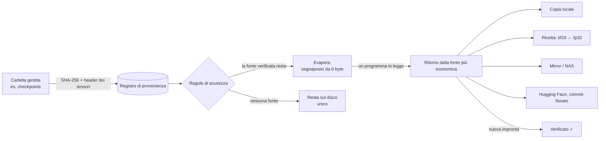

<p align="center"></p>

<h1 align="center">Marea</h1>

<p align="center"><b>I modelli di IA ti mangiano il disco. Marea ti restituisce lo spazio, senza cancellare un byte.</b></p>

<p align="center">
  <a href="../../README.md">English</a> ·
  <b>Italiano</b> ·
  <a href="README.es.md">Español</a> ·
  <a href="README.fr.md">Français</a> ·
  <a href="README.de.md">Deutsch</a>
</p>

---

📖 [Manuale utente (in inglese)](../MANUAL.md) · [Tester guide](../TESTING.md)

L'IA in locale pesa. Checkpoint di Hugging Face, modelli ComfyUI, LoRA, file GGUF, lo stesso
modello in fp32 **e** in bf16, lo stesso text encoder da 3 GB copiato in quattro app diverse…
Un disco da 1 TB si riempie in poche settimane.

Su una vera postazione di lavoro Marea ha analizzato **125 GB di modelli** e ne ha trovati
**71 che potevano lasciare il disco senza alcun rischio**:

- 18 GB di duplicati identici byte per byte;
- 44 GB identici a file pubblici su Hugging Face;
- 9 GB di pesi bf16 ricalcolabili **bit per bit** dai loro originali fp32.

Marea non cancella niente di tutto questo: lo **fa evaporare**. Ogni file resta nella sua
cartella, con il suo nome e la sua dimensione, ma occupa **0 byte** sul disco. Quando un
programma lo apre (ComfyUI, Python, qualunque cosa), Marea lo riporta al volo e **ne verifica
lo SHA-256**. Le tue app non se ne accorgono.

<p align="center"><picture><source media="(prefers-color-scheme: dark)" srcset="../images/tour-dark.gif"></picture></p>

## Cosa c'è di nuovo

I programmi di pulizia indovinano dal nome delle cartelle e ti chiedono *"lo cancello?"*. Gli
strumenti di deduplica vedono solo i file identici byte per byte. Marea **dimostra da dove si
può riavere ogni byte** e libera solo ciò che sa riportare indietro. Per quanto ne sappiamo,
nessun altro strumento mette insieme queste capacità:

| | Programmi di pulizia | Deduplica / hardlink | **Marea** |
|---|---|---|---|
| Sa da dove si può riavere un file | ✗ (nomi delle cartelle) | ✗ | **✓ prova crittografica (SHA-256)** |
| Libera spazio senza cancellare | ✗ (cancella o cestino) | in parte (solo file identici) | **✓ segnaposto da 0 byte** |
| Riporta i file da solo quando servono | ✗ | — | **✓ trasparente e verificato** |
| Riconosce le copie fp32 ↔ bf16 dello stesso modello | ✗ | ✗ | **✓ ricetta esatta al bit** |
| Confronta i file con gli hub pubblici | ✗ | ✗ | **✓ Hugging Face, fissato al commit** |
| Sceglie *cosa* liberare in base a costo del ritorno × uso recente | ✗ | ✗ | **✓ "la marea"** |

## Modelli e sicurezza

La pagina **Modelli** raggruppa i file in modelli (repository della cache Hugging Face, tag Ollama,
cartelle di modelli, checkpoint divisi in parti, file singoli) e mostra cosa sono, letto dalla loro
intestazione: **formato** (GGUF, safetensors, PyTorch, ONNX), **quantizzazione o precisione**
(`Q4_K_M`, `BF16`), **parametri**, dimensione e stato.

<p align="center"><picture><source media="(prefers-color-scheme: dark)" srcset="../images/dark/models.png"></picture></p>

Risponde anche a una domanda sempre più importante: **caricare questo modello potrebbe eseguire
codice?** I vecchi formati (`.ckpt`, `.pt`, `.pth`, molti `.bin`) usano il pickle di Python. Marea
ne legge le istruzioni **senza eseguirle** e dà un verdetto pacato: *Formato sicuro*, *Nessun codice
trovato*, *Da controllare* (import insoliti, codice TorchScript, template di chat GGUF che tentano di
uscire dalla sandbox) o *Pericoloso*. Per controllare un modello appena scaricato:
`mareactl check <file o cartella>`.

## Novità della 0.7

Ollama 0.40 ha convertito alcuni modelli GGUF e ha tenuto anche l'originale, solo per poter tornare a una versione precedente: quei modelli occupano il doppio. Marea ora trova queste **copie di rollback** e le libera senza cancellarle: se un giorno torni a un Ollama più vecchio, l'originale rientra da solo dal registro di Ollama.

## Novità della 0.6

Il controllo di sicurezza dei modelli ora funziona anche su **macOS e Linux**: scarica `marea-check` dalle Release (stessi verdetti, JSON e codici di uscita di `mareactl check`). Al primo avvio Marea trova anche le cartelle di **LM Studio, Jan e GPT4All**, e per i file presi da Hugging Face mostra cosa dicono **gli scanner di sicurezza di Hugging Face**.

## Novità della 0.5

**Condividi** salva un'immagine con i tuoi numeri (spazio liberato, modelli, zero byte cancellati), senza percorsi né nomi di file. Il filtro **Non usati da 90 giorni** trova i modelli dimenticati. E se un programma (antivirus, backup, altri gestori di modelli) riporta sul disco molti file evaporati in pochi minuti, Marea te lo dice e ti permette di **bloccarlo**: le sue letture falliscono e i file restano evaporati, mentre tutti gli altri programmi continuano ad aprirli.

## Modelli a rischio

I modelli spariscono: repository cancellati, resi privati o ad accesso limitato, file tolti in una nuova versione, tag Ollama ritirati. Ogni giorno Marea controlla le fonti pubbliche e coglie i segnali in anticipo, finché i byte fissati sono ancora serviti: **riporta sul disco** i file evaporati che dipendono solo da una fonte che sta sparendo, **non libera più** quelli che potrebbero essere l'ultima copia e li **copia sul mirror** (NAS). Un controllo fallito per rete non conta mai come segnale. Da riga di comando: `mareactl watch --json`.

<p align="center"><picture><source media="(prefers-color-scheme: dark)" srcset="../images/dark/models-risk.png"></picture></p>

## Pensato per gli agenti AI

`mareactl` è pronto per essere usato da assistenti AI: JSON versionato (`--json`), codici di uscita
chiari (`2` serve conferma, `3` da controllare, `4` pericoloso, `5` sola lettura), modalità
`MAREA_READONLY=1` che rifiuta ogni modifica, nessun cambiamento senza `--yes`. Il contratto completo
è in [docs/AGENTS.md](../AGENTS.md).

## Come funziona



| Classe | Prova | Torna da |
|---|---|---|
| **Duplicato** | stesso SHA-256 di un altro file sul disco | quella copia locale, in pochi secondi |
| **Derivabile** | si ricostruisce da altri file locali (es. bf16 da fp32), provato calcolando l'impronta della ricostruzione completa | un ricalcolo |
| **Riottenibile** | stesso SHA-256 di un file pubblico su Hugging Face fissato a un commit, o di una copia verificata sul NAS | download / rete locale |
| **Unico** | nessuna fonte nota | **non evapora mai**: replicalo prima sul NAS e diventa riottenibile |

**La marea** mantiene una soglia di spazio libero (100 GB di serie). Ordina i candidati per
*costo atteso* = probabilità che il file ti serva presto × secondi per riaverlo ÷ GB liberati.
Un duplicato che non tocchi da un mese esce per primo; un modello usato ieri resta. La modalità
automatica è **spenta di serie**: puoi anche liberare spazio a mano, rivedendo un piano.

Sotto il cofano Marea usa le **Cloud Files API di Windows**, lo stesso meccanismo dei file
"solo online" di OneDrive. Al posto del cloud c'è la provenienza di ogni file. Niente permessi
di amministratore, nessun driver suo, nessun servizio in background.

## Sicurezza

1. **Niente esce senza una via di ritorno indipendente e verificata** che continuerà a esistere
   anche dopo. Due copie non escono mai insieme, e le fonti di una ricetta restano bloccate.
2. **Prova all'ultimo istante.** Accesso esclusivo, nuova impronta di ogni byte, la fonte deve
   rispondere *adesso*, e i file con hardlink vengono rifiutati.
3. **Ogni byte che torna viene riverificato.**
4. **Una cartella non viene mai sganciata finché contiene segnaposto**, perché Windows li cancellerebbe.
5. **Decidi tu.** La prima scansione misura e basta. "Riporta tutto" è un clic, e il
   disinstallatore lo esegue **prima** di togliere qualsiasi file.
6. **Rete minima.** Solo HTTPS verso Hugging Face, con destinazioni ammesse controllate anche nei
   reindirizzamenti. Nessuna telemetria.

Dettagli: [SECURITY.md](../../SECURITY.md).

## Novità della 0.2

- **Fonti trovate da sole**: Marea ricava i repository di Hugging Face dagli indizi già sul disco
  (cache, `base_model` nei README, `_name_or_path` nei config, git, modelli Ollama da `hf.co`) e
  dagli altri repository dello stesso autore. Non serve scrivere nessuna lista.
- **Fonte Ollama**: i modelli scaricati con Ollama tornano dal suo registry, verificati per
  impronta. Se non usi Ollama non cambia nulla.
- **Avviso aggiornamenti**: una volta al giorno controlla GitHub e avvisa soltanto.
- **Release costruite da GitHub** con attestazione di provenienza:
  `gh attestation verify <file> --repo indecenti/marea`.
- **Prova sul campo**: 63,7 GB di modelli veri analizzati in 65 s; 19,9 GB liberati in 11 s;
  il modello bf16 ricalcolato dall'fp32 in 35 s e riletto da PyTorch identico bit per bit.

## Installazione

> **Pre-release.** Le build non sono ancora firmate: al primo avvio SmartScreen può avvisare
> (*Ulteriori informazioni → Esegui comunque*). Verifica il download con il file `.sha256`.

1. Scarica `Marea-<versione>-win-x64-portable.zip` da [Releases](https://github.com/indecenti/marea/releases).
2. Estrai lo ZIP dove vuoi e avvia **`Marea.exe`**. .NET è incluso.
3. Prima di cancellare la cartella usa *Impostazioni → Riporta tutto e sgancia*.

Requisiti: Windows 10 1809+ o Windows 11, x64, NTFS.

## Uso rapido

1. **Primo avvio**: una guida spiega cosa fa Marea e cosa non fa mai, poi trova da sola le
   cartelle di modelli. Togli la spunta a quelle che non vuoi far gestire.
2. **Scansione**: Marea calcola le impronte e cerca le fonti. Questo passo misura e basta.
3. **Libera spazio in 3 clic**: scegli *quanto* (10 GB, 50 GB, fino alla soglia o tutto
   quello che è sicuro) e *come devono tornare i file*. Con **solo istantaneo** usi duplicati e
   ricette, che tornano in secondi anche offline; in alternativa puoi includere anche NAS e
   internet. Poi premi **Libera ora**. Il pulsante **Annulla questa operazione** riporta
   esattamente quel gruppo di file. Chi vuole il controllo completo può aprire il piano dettagliato.
4. **Dimenticatene**: quando un programma apre un file evaporato, torna da solo. Lascia Marea
   attiva: ti propone di avviarsi con Windows.

## Riga di comando

```
mareactl status | add <cartella> | scan | plan | evaporate --yes | restore <file>
mareactl free [--gb N|--all] [--instant] --yes     liberazione rapida, annullabile
mareactl undo                                      annulla l'ultima liberazione
mareactl replicate | restore-all --yes | journal | agent
```

`MAREA_DATA` cambia la cartella dati, `MAREA_LANG` la lingua (`it`, `en`, `es`, `fr`, `de`).

## Domande frequenti

**E se Marea non è attiva quando un programma apre un file evaporato?** Il programma riceve un
errore, come con OneDrive chiuso. Riavvia Marea e tutto torna a funzionare.

**Posso perdere un file?** Marea è progettata per impedirlo. Evapora solo file con una fonte
verificata che sopravvive all'operazione e riverifica al ritorno. I file unici non vengono mai toccati.

**Serve internet?** Solo per i file la cui fonte è Hugging Face. Duplicati, ricette e copie sul
NAS tornano anche offline.

**Cosa invia in rete?** Solo i nomi dei repository pubblici impostati e le richieste dei file
pubblici. Mai percorsi, nomi di file o impronte dei tuoi file.

**macOS / Linux?** Il motore è .NET portabile. Serve un nuovo strato segnaposto: File Provider
su macOS, fanotify o FUSE su Linux. Contributi benvenuti.

## Contribuire

Leggi [CONTRIBUTING.md](../../CONTRIBUTING.md): la regola è *mai perdere un byte*. Le
vulnerabilità si segnalano in privato (vedi [SECURITY.md](../../SECURITY.md)).

## Licenza

[MIT](../../LICENSE) © Marea contributors
